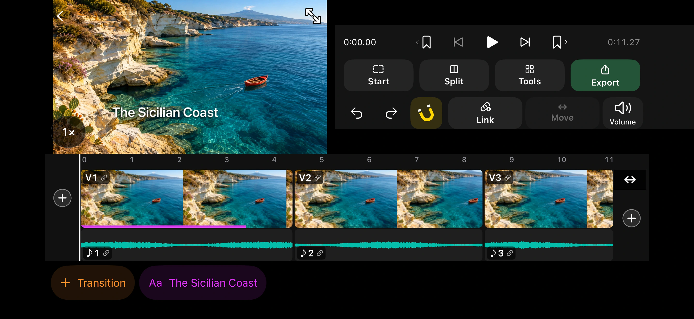
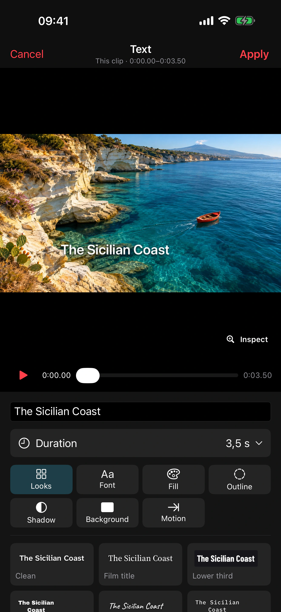
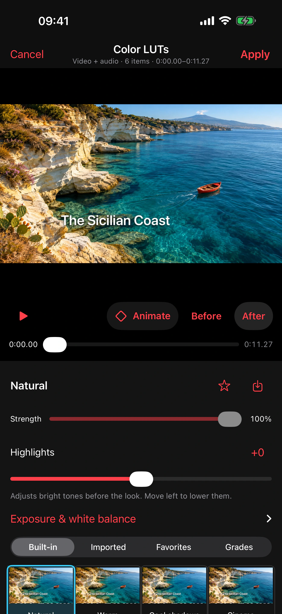

# YouRec

YouRec is a native iPhone camera and multitrack video editor for iOS 17 and later. After two years of running a [YouTube channel](https://youtube.com/antirez) and editing my videos in DaVinci Resolve™, I had two frustrations.

1. The iPhone Camera app doesn’t give me the controls I want. I want to switch between the front and rear cameras while recording, track my face, have more control over dual-camera layouts, and append new footage to an existing video.
2. DaVinci Resolve is powerful, but it’s often more than I need. I record for 20 minutes a day, often while driving. My YouTube channel is a side project, and I can’t give it more than 5% of my day. Often I just want to make a few quick, creative edits, and I could do many of them right on my iPhone. I started to picture the app I wanted.

YouRec is the app I wished I had. It’s powerful and free. I wanted tasteful effects with some character, so I chose each one carefully. I also wanted editing tools that make sense the first time you use them.

The rest of this README is AI-generated, so think of it as a reference manual. YouRec is available on the App Store for iPhone, so you only need to build it yourself if you want to make changes.

Feel free to open issues or send pull requests, though I can only take on a handful from time to time. If you can, resist the temptation to spam the App Store with copies of this app. You’re welcome to use the code. The YouRec name is reserved.

To learn more, see the [project specification](SPEC.md).

## Editing a video in YouRec

The timeline shows three clips from *The Sicilian Coast* with their audio waveforms underneath. Move the playhead and tap **Split** to make a cut. Tap the title or transition below the timeline to edit it again.

[](docs/screenshots/timeline.webp)

Use **Text** to place a title on the picture and choose how long it stays on screen. In **Color LUTs**, choose a look, adjust its strength, and tap **Before** or **After** to compare the grade on the same frame.

<p align="center">
  <a href="docs/screenshots/text-overlay.webp"></a>
  <a href="docs/screenshots/color-luts.webp"></a>
</p>

## Current build

The recorder uses a full-screen camera preview with minimal overlaid controls.
Camera, zoom and focus sit above the recording button. The top-right controls
open Effects and Camera settings. Camera settings contains Stabilize, Follow
face, Front light, the two-camera controls and SDR/HDR/Log. **More settings**
opens quality, focus, microphone preferences and other recording options.
Projects and Editor are separate destinations.

Implemented:

- **Subtitles** from Qwen3-ASR-0.6B: one optional 713 MB download, then offline.
  Transcribe a selection or the project, regroup by word limit, correct phrases,
  style captions and render them in preview/export. Pause-based word times are
  approximate; edits carry captions with speech. [Details](docs/SUBTITLES.md).
- Manage TTF, OTF, TTC and OTC files under **Tools → Settings → Fonts**. In Text or Subtitles, **Font → Import** opens the same library. Projects keep the fonts used in their edits and include them in duplicates and project ZIPs.

- Front-camera preview behaves like a mirror by default; saved selfies are
  unmirrored by default. Settings independently control both. HDR defaults on
  where supported; choose SDR/HDR/Log before recording or while paused. HDR captures
  use 10-bit HEVC/HLG and remain HDR through editing/export; SDR uses H.264/Rec.709.
  Compatible cameras can capture Apple Log / Apple Log 2 in 10-bit HEVC, with
  display conversion for monitoring and untouched Log source recordings.
  Physical 17 Pro Log capture is verified at 1080p/4K; see [Log and LUTs](docs/log-and-luts.md).
- Real camera/microphone capture into immutable source segments. Pause, Stop and
  later continuation append to the same project, including after app relaunch.
- Runtime camera discovery and switching. Independent per-camera zoom and focus
  memory; zoom presets and timed ramps; fixed focus and manual lens control where
  hardware permits. A sample-buffer writer and independent microphone engine
  keep audio running while cameras switch; the image holds during the camera
  transition.
- Microphone selection, remembered preference ranking, active route name and level
  before and during recording. No automatic upgrade during a take; fallback on
  microphone loss. Manual selection is separate from persistent priority, which
  includes remembered disconnected microphones.
- An iOS 26 capability-gated upright-phone landscape selfie option, using a wide
  sensor crop and an entire-frame preview rather than rotating the scene. This
  needs a compatible front camera; the iPhone 14 Pro Max cannot validate it.
- Large editor preview, shared scrolling thumbnail/waveform timeline, pinch/step
  zoom, cut/effect navigation (hold to skip plain cuts), range marking/deletion,
  cut audition, trim handles/reorder. Tap the preview to play/pause; scrubbing
  pauses playback and stays paused after release.
  Pinch the playing preview to inspect detail, drag while enlarged, and use its
  reset icon to return to the fitted view; inspection never affects export.
  Persistent projects, video import, and
  persistent linear undo/redo. YouRec keeps five recent project indexes, reopens
  playable interrupted takes, and offers **Changes not saved → Retry** when a
  write fails. In **Projects → … → Original recordings**, review or save the
  source footage independently of the edit. **Duplicate project** creates a separately editable copy with its source media and undo/redo history. **Zip project** includes the originals, YouRec editing history and an OpenTimelineIO edit. Unzip and import the .otio file into DaVinci Resolve to continue working with the source clips. YouRec-specific processing, mixes, and custom transitions can be recreated in the external editor.
- Open movie export from the editor or the share icon at the bottom right of a project card. Share the finished movie or save it to Photos.
- **Tools → Select cover** shows frames from the edited project or your selection. Tap **Update** for more choices, then open a frame and use the share arrow to save or send its full-resolution JPEG.
- **Bookmarks** during recording and editing, with thumbnails, labels, previous/next
  navigation and source-relative timing through splits, trims and moves. Pinch can
  zoom out to fit the whole project, without the former ~201-second limit.
- Independent video/audio lanes with **Unlink**, component selection, **Move**
  (draft, frame nudges, snapping, Done/Cancel) and audio-only **Volume**.
  Volume includes independent **Fade in** and **Fade out** times. Drag to set a
  duration or tap the value to enter seconds. Each play button auditions its
  edge. With several audio clips selected, only the earliest start and latest
  end receive the respective fades. With no selection, those edges come from
  the whole project.
  While moving, choose **Selected only**, **With left**, **With right**, or
  **Both sides**. Each side follows cuts and transitions up to the first gap.
  Linked sound travels with its picture. The timeline highlights the moving
  group before you drag, and one Undo restores the move.
  Deleting linked video + audio closes the gap; deleting an unlinked component
  leaves a gap. Move the playhead into an overlap and tap **Placement** in the
  timeline bar to arrange the videos with drag/pinch, Fit/Fill, reframing,
  presets and front/back ordering. Four edge circles crop
  each picture independently without resizing it; **Reset crop** restores it.
  **Full** expands the same
  player; double-tap Play performs quick review and returns to its saved anchor.
- Cut selected footage and paste at the playhead within the same project. The
  clipboard survives leaving the editor during the session; pasted effects are
  independent copies. Snapping to cuts defaults on and can be disabled in the
  editor’s Tools → Settings section. Scrubbing pauses playback.
  The preview's bottom-left speed control offers 1×, 1.5×, 2×, 2.5× and 3× review
  with preserved pitch, without altering the edit/export.
- **Video or photo** inserts photos and videos at the playhead in the numbered
  order you pick them. Each photo becomes a silent three-second clip. Multiple
  unused takes can also be selected and reordered.
  Tap **+** at either end of the filmstrip or inside a visible video gap to open
  the same picker there. A gap fills from the clip on its left, shifting later clips
  only by the overflow. At the start, the new footage ends flush with the first
  video. Each batch takes one Undo or Redo. Record-here
  sessions form one undoable insertion, including pause/resume segments. Normal
  recording continues to append with baseline protection. Source files stay
  available after Undo. Insertion preserves the canvas shape.
- **Add audio** imports WAV, AIFF, M4A, MP3 and other system-supported sound files
  through Files. It adds an independent layer at the playhead without shifting
  existing clips. Move, trim, Volume, Enhance audio, Undo and project archives
  work with imported sound; the original file is copied and left unchanged.
- **Censor audio** replaces sound in a marked range with a generated beep. Choose
  sine, triangle or square, frequency, level and a smooth or pulsed envelope.
  Select an audio item to target that track, or leave items unselected to affect
  all audio in the range. Audition on demand, then Apply; timeline badges reopen
  the settings. Remove and Undo restore the original sound. The original stays
  muted during the beep's fades and pulse gaps. Sources are never overwritten.
- **Mirror** flips selected footage horizontally/vertically while keeping titles
  and images readable. **Image** adds timed overlays with drag/pinch placement,
  size/opacity/position controls, replacement, timeline re-editing and undo/redo.
  Image assets travel with project archives, including assets referenced by redo.
- A **Tools** panel with explicit selected-range / selected-clip / whole-project
  scope, coloured timeline effect spans and tappable chips for editing/removal.
  Timed text supports four styles, six colours, drag/pinch placement and duration
  controls. Color LUTs includes thirteen creative looks plus Natural, imported
  1D/3D `.cube` files, favorites and named grades. Look strength is separate from
  exposure/white balance and technical Log conversion. Log footage also offers
  **Local highlight recovery**: a 0–100% control with a Natural preset to retain
  bright-area texture without lowering the whole shot's exposure. It is off by
  default, saved with grades, and shared by preview and export. LUT assets travel with
  project archives and Undo/Redo. Editable pause cuts
  have silence threshold, minimum duration, independent padding and remembered
  keep/cut choices. Speed ranges from 0.25× to 4× with audio pitch preserved.
  Shared effects survive splitting and are edited together; source-anchored text
  follows timing changes. Preview and export share one visual pipeline.
- Effect inspectors have a reachable **?** beside the title for practical help
  and relevant film-history notes. Utility effects omit historical filler.
  **Remove all subtitles** sits before the full transcript, so a long transcript
  does not bury it.
- **Crop** under Tools uses pinch/pan framing, optional position sliders, Reset,
  and a full playback preview. It applies to the selected range/clip or whole
  project. Video-shape presets are explicitly project-wide, with output dimensions
  pinned across reordering. Crops reopen from timeline chips and support persistent
  undo/redo. Uncropped footage keeps its full picture when the output shape changes.
- Offline editor stabilization under **Tools**, with Off / Light / Standard / Strong levels,
  a large preview, Original/Stabilized comparison, explicit crop factor, and
  per-clip persistent undo/redo. Splitting a stabilized take reuses its motion
  analysis and framing. Preview and export use the same correction, preserve
  recorded zoom timing, and keep source files unchanged. See
  [stabilization](docs/STABILIZATION.md) for the algorithm and verification.
- **Enhance audio** under Tools applies an ordered audio chain to selected sound
  or the whole project, with selectable RNNoise / DeepFilterNet3 noise reduction, Core ML LavaSR v2
  speech-detail restoration, full-band VoiceFixer Studio restoration, and repeatable
  low-cut, parametric EQ and gain stages,
  colored vertical parameter controls, per-stage bypass, drag reordering,
  selected-stage settings below the chain, and saved undo/redo. Processed preview and export
  use the same cached per-source audio. Models retain context from the original
  take across cuts. Processing is offline and cancellable. Completed filter stages are reused when
  later stages change, and restoration resumes from completed context windows.
- New MP4 exports with edit/source-checksum receipts, Files sharing and explicit
  Save to Photos. Completion plays a short chime; export keeps the screen awake
  and shows Cancel until finished. An unchanged completed edit offers sharing
  instead of a duplicate Export button. Sources remain unchanged. Preview-only listening-level matching
  compares audible sections in both versions without changing exported gain;
  suppressed noise and near-silence never turn down the bypassed preview.
- Project thumbnails, renaming, reversible Recently Deleted, portable project ZIPs
  with every original and complete undo/redo, checksum-checked restore, and missing
  media relinking. Damaged/missing archive entries retain their editing history;
  removing unavailable takes is an undoable edit. Interrupted imports clean up
  only their own marked working directories.
- Recording additions remain present through editor Undo/Redo, including when
  recording continues after earlier edits. Explicit clip deletion is undoable;
  every original is retained even when it is absent from the timeline.

Projects advance their schema as new features are used. For example, imported audio and censoring require schema 9.
Older builds refuse these projects instead of silently losing edits or revealing
censored speech.

Interrupted video exports restart the video render; completed audio stages and restoration windows are
reused while retained in the storage cache. Background time is limited by iOS;
returning to Recorder cancels heavy editor work. Full-screen preview fills the screen and can crop the preview; the
Framing setting can show the entire recorded frame. Sources keep the full capture.
The Enhance audio inspector offers Bypass/Enhanced comparison of its selected
chain during playback. Comparison stays inside that inspector; the main editor
always plays the committed audio. Tap a column for settings, drag its body vertically to
adjust, or hold its top grip to reorder. Long chains scroll horizontally.
Recorder camera switches hold the last preview frame while the destination
camera starts. The icon left of the camera name recalls the last front/back lens.
Routine switching holds are saved as recording events without a warning banner.
Clear removes either a Start mark or a completed range without deleting footage.
Double-tap Play and Preview cut return to the playhead where they were started.
Edit snapshots are immutable files referenced by a small atomic manifest. A
separate capture ledger keeps ordinary new recordings present through Undo/Redo.

## Run on the connected iPhone

Generate the VoiceFixer model before the first build. For a device build, select
your own signing team in Xcode and use a bundle identifier registered to that
team. Select the connected iPhone and press Run (⌘R). Allow camera and
microphone access when prompted.

Studio restoration uses the full-band VoiceFixer neural network, separately from
LavaSR's speech-detail restoration. It runs offline and is bundled in the app.
The roughly 200 MB generated model is excluded from Git: on a new checkout,
first follow [VoiceFixer conversion instructions](ThirdParty/VoiceFixer/PROVENANCE.md).
The weights are CC BY 4.0; model attribution and conversion details are included
in the app and third-party notices. This restores recording defects rather than
emulating a named microphone, and can change vocal character.

The command line can build, install, and launch when it has device/keychain access:

```sh
xcrun devicectl list devices
./scripts/run-on-iphone.sh <device-id>
```

An unsigned compile is also available:

```sh
xcodebuild -project YouRec.xcodeproj -scheme YouRec \
  -configuration Debug -destination 'generic/platform=iOS' \
  -derivedDataPath build CODE_SIGNING_ALLOWED=NO build
```

## TestFlight releases

For publishing a beta, continuing distribution after an upload, and renewing
the release Mac’s signing assets, see the [release guide](RELEASE.md).

## Verification

Camera changes must follow the [physical-camera acceptance process](docs/CAMERA-QA.md).
Simulator layout tests do not establish correct sensor framing or saved output.

```sh
./scripts/test-core.sh
# Only persistence and DSP, without media decoding/export:
./scripts/test-core.sh --core-only
```

Requires Xcode and ffmpeg. The full test exercises persistent undo/redo and redo
branch replacement, document validation, exact bypass, repeated gain stages,
filter stability and channel independence, waveform decoding, video trimming,
audio-chain export, source preservation, and refusal to overwrite exports.
Use the physical-camera procedure above to verify camera continuity and microphone fallback.

Physical testing on the iPhone 14 Pro Max has exercised all four cameras at
1080p and 4K, independent zoom/fixed-focus restoration, live switching, rejected
switch then Pause/Resume, and rapid Record/Stop. A continuous 60-minute recording
with camera changes finished as one file; audio/video duration differed by
0.58 ms, audio packets had no gaps above 1 ms, and all 60 thermal checkpoints
were nominal. This is timestamp evidence, not a clap/lip-sync listening test.

Five simulator UI tests cover cuts (including during audio processing), persistent history across relaunch, audio
chains, accessibility text in portrait/landscape, project rename/delete/restore,
and actual export to Photos. External microphone disconnection, physical
interruptions, the iPhone 17 Pro landscape selfie
feature, and outdoor/one-handed usability still need further validation.

The video effects share Metal shaders between preview and export, with saved
parameters, keyframes and reusable palettes. Heavy live combinations use adaptive
preview resolution; original footage and exports retain full resolution. Recording
keeps the full camera/zoom controls. Original Cinematic imports can supply depth
for editor Dolly Zoom and oval bokeh; ordinary clips use person separation for
Dolly. The current simulator SDK lacks Cinematic, so depth rendering is checked
on the physical iPhone. See [video-effect implementation and QA](docs/VIDEO-EFFECTS.md).

Color Correction adds exposure, contrast, tonal ranges, white balance, saturation,
vibrance and hue in compact Light/Color tabs, with range scope and keyframes.

Video effects use original Swift/Metal code and Apple frameworks.

## License

YouRec’s original source code is released under the [MIT License](LICENSE).
That file also credits the dependencies and identifies their licenses.
[Third-party notices](THIRD_PARTY_NOTICES.md) include versions, sources and license texts.
