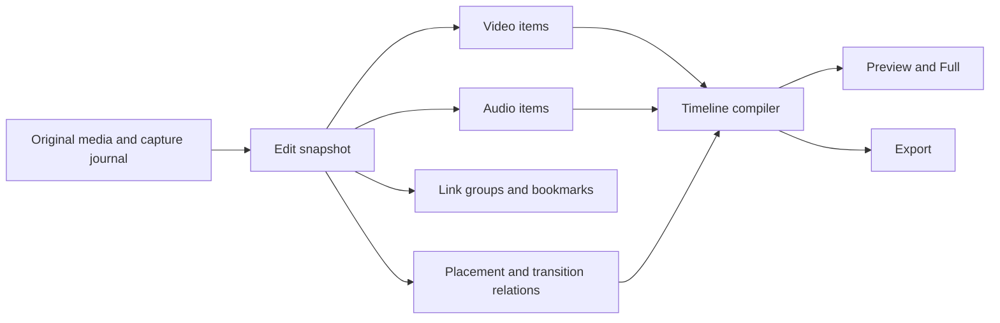

# Independent tracks, bookmarks and audio tools

## Intended experience

Recording stays a full-screen camera with a small bookmark button. One tap marks
a mistake without interrupting the take. In editing, picture and sound normally
behave as a linked pair. Unlink makes them independently selectable. Move is an
explicit mode, so ordinary scrubbing cannot accidentally move footage. Enhance
audio joins the existing Tools panel and follows the same selection, Apply,
Cancel, re-edit and Undo conventions as the other tools.

The UI must say which material an operation affects: **Video + audio**, **Video**,
or **Audio**, followed by the selected clip/range. A selection outline, icon and
label communicate this together; color alone does not.

## Confirmed deletion and overlap behavior

1. **Delete linked video + audio:** remove the selected material and close the
   resulting gap automatically, in one undoable operation.
2. **Delete unlinked video or audio:** leave the gap. Do not delete, trim or move
   the other component, or shift later items. Unlinking must never make a
   component-only deletion shorten the other component's timeline.
3. **Initial overlap picture:** one video covers the other. **Placement** contains
   the foreground/background ordering controls alongside position, zoom and
   reframing; changing layer order does not require a separate tool.

Other proposed defaults: bookmarks store the exact tap position; jumping seeks
to the mark, with an optional short lead-in when reviewing mistakes. An overlap
does not automatically create a transition. All overlapping audio is mixed until
the user adjusts or mutes it. More than two overlapping videos require expandable
lanes rather than shrinking touch targets below 44 points; the data model has no
two-video restriction. Device limits must be measured before setting a UI limit.

Timing edits such as Speed and Pauses also need a declared ripple policy. The
default proposed here is to preserve unrelated item positions for component-only
edits; a full-program edit can explicitly remove/insert project time. The inspector
must preview the resulting gaps/overlaps and duration before Apply. Complete
linked-pair deletion follows the automatic gap-closing rule above.

## Product behavior

### Bookmarks

- A bookmark button in the recorder acknowledges a mark immediately and quietly;
  no modal, recording interruption or audible tone. Capture records the media
  timestamp, not a timer read from the UI. Convert the tap's host-clock time into
  the capture session clock on the writer queue, using the same timestamp
  normalization/corrections as the actual recording. The clock advances during a
  frozen video hold even though the last camera frame does not. Mark is enabled
  during an active take; normal editor bookmarks cover already recorded material.
  Marks survive pause/resume, camera
  changes, Stop, app restart and recording recovery.
- A bookmark control beside the editor's timeline scale offers **Add bookmark**
  and a list with time, thumbnail and optional label. Previous/next controls allow
  stepping through marks without reopening the list. The same navigation is
  available in Full preview. Navigating while playing continues playback.
- In a dense overview, marks cluster visually; the list retains every mark.
  Tap opens the cluster/list rather than selecting an arbitrary overlapping flag.
- Recording bookmarks follow the source footage. Editor bookmarks attach to the
  selected occurrence of that footage; a bookmark placed in empty timeline space
  is anchored to project time. Splitting does not duplicate a boundary mark.
  Moving, changing speed and trimming map marks through the same timing map as
  playback. Marks outside the visible edit remain available with the original
  take and return with Undo.
- Holds/generated clips need an item-local anchor: a source frame can occupy
  several seconds, so source time alone cannot identify a mark halfway through a
  freeze. Preserve that offset and lineage when splitting the hold. Captured marks
  are not automatically duplicated into newly generated holds.
- Capture warnings remain distinct from user bookmarks. Warnings do not fill the
  bookmark navigator or count.

### Timeline scale

The observed ~201-second limit comes from `EditorTimeline.pinched`, which clamps
the scale to at least two points per second. The menu in `EditorView` allows
smaller values, so pinching after choosing five minutes can actually zoom in.

Replace these separate calculations with one viewport model used by pinch,
presets, labels, scrolling, hit testing and thumbnail/waveform sampling. Its
minimum scale depends on project duration and usable width, not a fixed two
points per second. Preserve the anchor time through pinch and rotation; never
change the actual edit or seek as an accidental consequence of scale clamping.
**Whole project** must actually include both project ends. The viewport and
playhead are separate state so fitting the project need not change playback.
For normal scrubbing, retain the familiar playhead-centered interaction.

Render only visible intervals. Use progressively coarser thumbnails, waveform
bins and ruler ticks as the view expands. A 16-minute or multi-hour project must
not allocate a bitmap/view as wide as the entire frame-level timeline.

### Selection, Unlink, Move and Volume

The row to the right of Undo/Redo has stable action slots: **Unlink/Link**, **Move**,
and **Volume**. Volume becomes available when only audio is selected. Bookmarks
live with timeline navigation rather than replacing Volume dynamically.

- A linked pair selects together, whether tapped on its picture or waveform.
  Tapping the selected item again clears it. Unlink is one undoable operation;
  it changes no samples, position, duration, gain or effects.
- After Unlink, the thumbnail selects video and the waveform selects audio.
  Their selection outlines and status labels are independent. Split, Cut, Copy,
  Delete, trims and tools operate only on the declared targets.
- Link groups control joint editing; they do not imply that audio is synchronized.
  Re-linking must not silently move either component. A displaced original pair
  shows its offset and can offer **Restore sync** as a separate explicit action.
- Move opens a temporary editing mode with a ghost outline, start time and signed
  offset. Drag the selected item horizontally; linked components move together.
  **Done** commits one Undo step, including repeated adjustments. **Cancel** returns
  to the original positions. Empty space still scrolls; trim gestures are disabled
  while moving. Edge scrolling, snapping and frame nudges work in this mode.
- Snap candidates include stationary clip edges, the playhead and bookmarks.
  Exclude the moving group itself, deduplicate linked edges, display the snap
  target, and use hysteresis to prevent oscillation. Respect the magnet setting.
- Volume opens an audio-only panel with a dB slider, mute and reset to 0 dB.
  Apply it to the selected clip/range. It changes neither video nor AI filter
  settings. Leave headroom and show overloads; do not silently normalize every mix.

Range selection stores both a time interval and explicit target identities. A
range does not become “all tracks” just because its previously selected item was
removed. Moving a partial range first splits the affected items, in the same
transaction, without modifying their source files.

**Delete** distinguishes linked-pair and independent-component selections. A
linked-pair deletion closes the gap automatically by moving the following linked
sequence earlier; both components move together. A component-only deletion leaves
empty video or silent audio time and moves nothing. Resolve the affected downstream
items explicitly in the command: independent overlays and detached audio retain
their positions and are never cut merely to close a gap in the linked sequence.
Source/occurrence bookmarks follow their material; project-time marks retain their
time unless the operation explicitly removes project time. Undo restores removed
items and every affected position together.

A separate **Close gap** operation removes empty project time across all lanes
and shifts project-time marks as well. It is available only when that interval is
empty on every lane. It must not be required for ordinary linked-pair deletion,
and must never delete unselected media just to make a ripple possible.
Component Paste overlays/inserts the copied item at the playhead without moving
other items.
**Insert time** is a distinct command: split crossing items, preserve the pieces,
and shift the right-hand pieces together. Record here uses that explicit insertion
behavior. Nothing overwrites another clip as a side effect of a drag or paste.

### Overlapping video and Placement

At overlapping time ranges, the timeline shows the videos in separate vertical
lanes. Outside the overlap it remains compact. Keep lane ordering stable during
a drag and expand crowded lanes for selection rather than making tiny hit areas.
Audio keeps its own waveform lanes; it is not visually attached to the wrong
video after unlinking or moving.

At an overlap, a **Placement** bubble appears alongside the other active tools.

Each selected picture has four midpoint circles. Dragging an edge clips that
side without moving or scaling the picture; the lower video becomes visible.
Crop margins are independent of the window transform and content framing.
In Fit mode they refer to the displayed picture, excluding transparent bands.
Moving and resizing preserve the crop, and resize keeps the visible centre
steady. Reset crop restores the hidden area without resetting framing or order.
Layout presets explicitly reset crop, framing and Fit. Apply commits one undoable
change; Cancel discards the draft. Schema 7 prevents earlier app versions from
silently losing crop data in saved history.

Handles have outward-biased 44-point targets, leaving an interior for moving
small windows, plus adjustable VoiceOver controls. Cropping stops at a 44-point
visible span where possible; rotation or Fit may make an existing crop smaller,
but touching it never forces it to grow. The renderer clips after the original
picture transform, using the same geometry as the immediate gesture feedback.
The default composite puts the foreground video over the background, preserving
each video's existing framing. The moved/inserted video starts in front when it
creates a new overlap; saved layer order remains stable during playback and
reopening. Its panel shows the actual composite and a clearly selected video.
**Bring to front** and **Send to back** change the order in this same panel.
Presets include covering, side by side, top/bottom, picture in picture and free
placement. Drag positions
the selected video window; pinch changes its size. **Reframe** adjusts its content
inside that window, using the Crop interaction. Fit/Fill, centering, reset and
front/back order are explicit controls. Touching an occluded video is also possible
through the video selector. Apply, Cancel, remove and Undo work as with other tools.

Placement belongs to an exact set of participant occurrences. Use lineage plus
occurrence identity so splitting a clip preserves the relationship while copying
creates a new occurrence. The compiler derives the overlap boundaries from those
participants; a stored floating time interval must not drift away from them.
Partition overlaps by their complete active set: an A+B+C interval has one layout,
not competing A+B and B+C transforms for B. A newly formed set starts with the
chosen default; previous A+B layout remains on the A+B intervals. Removing the
last co-occurrence removes its layout in the same undoable transaction. Copies
do not inherit relationships with the original's neighbors.

### Transitions and timing changes

A transition is an explicit blend relation between the outgoing edge of A and
incoming edge of B. Its participants are identities, never current array indices.
On an existing overlap it uses that overlap. At a straight cut, the inspector
previews the movement needed to create the real overlap (for example, **Moves the
next clip earlier by 2 s**), including linked audio. Moving later material is an
explicit ripple option; it cannot silently move independent clips. This preserves
the established shortening behavior in a simple sequential project when ripple
is selected, while keeping independent tracks under user control.

If a later edit changes a still-valid edge intersection, resolve the feasible
duration and show it in the transition bubble. If a move, trim, split or deletion
breaks the edge relation, remove the transition in the same transaction, show
**Transition removed · Undo**, and never apply it to a replacement neighbor.
Moving both participants by the same amount preserves the transition exactly.
Opening/closing fades follow their owning item edge. Holds that add time are
explicit generated timeline items; the compositor cannot fabricate hidden time.

Placement and a transition are alternative treatments of their shared blend
interval; applying either replaces the other there, with that consequence shown
in the draft. Third-party concurrent layers composite outside that pair treatment
in the declared z-order. Removing a transition normally retains explicit item
positions; **Restore straight cut** is a separate timing operation, with a preview
of what it moves. No effect-removal command silently restores stale positions.

### Enhance audio

Remove Original/Processed and the audio-panel shortcut from the main editor row.
Add **Enhance audio** to Tools. It uses the existing chain of AI filters and EQ,
including enable/disable, order, amounts and detailed settings. The selected audio
range is shown at the top. With no selection, the target is all project audio.
With video selected, resolve its linked audio; a silent or unlinked video must not
silently target another audio track.

Enhanced intervals have an audio-lane indicator and a re-editable effect bubble.
There is one ordered chain per interval. Applying a different chain to part of
an interval splits the interval; it does not secretly run two complete chains.
Repeated filters within the explicit chain remain supported. Selecting mixed
chains must say so before replacing their settings.

The inspector is a draft. Preview processes a useful audition range; Apply commits
the chosen settings to the declared scope. AI jobs are cancellable and reusable.
If a committed result is still preparing, the editor must clearly identify what
audio is being heard; it must never silently substitute stale output or silence.
Export waits for the committed result. Bypass comparison, if offered, stays inside
this inspector and does not become another persistent global playback state.

### Full and double-tap Play

**Full** replaces Listen/Preview cut in the editor toolbar. It expands the actual
composited result, including independent sound, overlays and enhancements. Reuse
the same playback session and clock. Provide a scrubber, time, play/pause, speed,
bookmark navigation and a close control; one tap reveals hidden controls.
Leaving Full keeps the chosen playback position and playing/paused state while
preserving the editor selection and scroll scale.

Double-tapping Play performs the old quick audition: one second before/after the
anchor, or a preview of removing the selected range. It returns to its saved anchor
when finished. From pause, defer the single Play action until the double-tap window
expires (approximately 250 ms; measure on device), with immediate visual feedback.
From playing, the first tap pauses immediately; a second tap starts review from
the anchor captured on the first tap. It never starts and stops playback twice.
Keep a visible **Preview cut** action in the range-selection bar as well, and expose
an accessible **Quick review** action. Keyboard/VoiceOver Play does not wait for
double-tap recognition. Cancelling a review restores the normal
session before Full opens or another edit starts.

## Representation and execution



The current `EditState.clips` array implies sequence position; `TimelineClip`
owns video and audio together and `EditState.effects` is global audio processing.
That representation cannot express the requested independent timing cleanly.

Use a new edit schema with:

| Record | Essential fields and responsibility |
| --- | --- |
| Media asset | Stable ID, original file, track IDs, timing metadata, fingerprint, capture marks; separate from undoable edits. |
| Video item | Instance/lineage ID, asset track, explicit project start, source playback map, video tools and overlays, layer order. |
| Audio item | Instance/lineage ID, asset track, explicit project start, independent playback map, gain envelope and enhancement regions. |
| Playback map | Ordered source runs plus holds; maps source, item-local and project time both ways. Handles speed, pauses and freezes explicitly. |
| Link group | Member identities and their relationship; grouping does not rewrite timing or claim synchronization. |
| Bookmark | ID, label and source-occurrence or project-time anchor; capture provenance and editing overrides remain distinct. |
| Placement region | Participant occurrence/lineage identities, derived active intersections, normalized windows, content framing and z-order. |
| Transition relation | Exact participants, visual/audio timing and envelopes; never reassigned to accidental neighbors. |
| Edit snapshot | Items, relations, editing bookmarks and canvas; fully sufficient for deterministic Undo/Redo. |

Keep original source timestamps and timebases, and use a canonical **240,000 ticks
per second** for edit boundaries and project positions. This exactly represents
48 kHz audio samples and the supported standard/NTSC frame durations. Arbitrary
source timestamps are rounded once on entry; retain the originals for frame
selection. Rates use bounded rational values. Use integer accumulation with a
documented residual-rounding policy; do not grow arbitrary rational denominators
through repeated edits or separately round one join in different render paths.
Intervals are half-open. Convert to display seconds only at the UI boundary.
Gaps are empty
time, not fabricated black/silent source files. Duration is the maximum end across
both audio and video items, so moving sound beyond picture does not truncate it.

A pure compiler partitions the timeline at source-run, item, effect, placement and
transition boundaries. Each interval describes active video layers, exact source
samples/transforms and audio contributions/envelopes. The editor, hit testing,
waveforms, effect bubbles, Full preview and export consume this common plan.
Rendering must not normalize/mutate the saved edit or infer a different order.
Audio-only projects and video gaps have a defined black canvas; video-only gaps in
sound are silence. Decoder/track allocation is bounded and follows concurrent
intervals, not the number of edits in a long project.

An edit command resolves its selection once, creates a draft snapshot, validates
it and commits atomically. Pointer movement does not write history, rerun AI or
rewrite files. Stale render tasks have generation IDs and cancellation; finishing
an older job cannot replace the newly selected result. Existing source retention
and cache leases remain useful.

The normal editor layout remains recognizable:

```text
                    Video preview
  current time     previous  Play  next     duration
  Bookmarks: previous / list / next          view span
  ┌──────────────── video items ─────────────────────┐
  │ two selectable lanes where videos overlap       │
  ├──────────────── audio waveforms ────────────────┤
  └─────────────────────────────────────────────────┘
  Video / Audio scope · range · Preview cut · Delete · ×
        Split        Mark start        Full        Tools
  Undo  Redo                 Unlink     Move     Volume*
  * Volume appears for an audio-only selection.
```

On landscape phones, the preview retains the large area and controls use the
existing compact layout. Expand/scroll timeline lanes as needed; do not squeeze
four interactive lanes into a fixed 112-point band. Produce portrait, landscape,
overlap and audio-only interactive prototypes before committing the final layout.

### Storage and durable history

Use a small project manifest plus immutable files for committed edit snapshots,
written by a serial storage actor. Write a complete state file, then atomically
publish its manifest pointer. Undo/Redo updates the pointer; opening the library
does not decode every project's entire history. A cancelled drag writes nothing.
An obsolete AI completion cannot commit a snapshot. Disk failures keep the last
durable state and an explicit unsaved draft; they cannot half-update a history.
Archive export must include the referenced history and media inventory.

Capture additions need special treatment because they must survive Undo. Keep an
append-only capture ledger and store a capture cursor in each snapshot. Materialize
later ordinary append events onto an older snapshot using stable item/link IDs at
that snapshot's end. A subsequent edit snapshots the latest cursor, so a deliberate
deletion is not resurrected. Record-here assets enter the ledger as insertion-mode
events and become visible through their undoable insertion command, rather than
being automatically appended. This avoids rewriting all immutable history files
whenever a take finishes. Property-test cursor advancement, partial recovery,
branching after Undo, and adding a take while a redo branch exists before adoption.

### Audio processing order and caching

Keep the reusable neural/EQ results in source time. Cache identity includes source
fingerprint/track, chain and model versions, processing format, and deterministic
chunk/context policy. Moving a clip must not rerun its neural models. Source time
and processing context must not accidentally include audio from a different take.
Begin with the existing complete-source streaming results and reusable stage
prefixes. Add source-aligned chunks only after each model passes a continuity and
alignment gate against the complete-source result. A fixed two-second warm-up is
not proof that recurrent model state has converged. Models without deterministic
state checkpointing or validated chunk equivalence stay on the complete-source
path. Processing only a short selection may consequently still require a full
source pass the first time; show truthful progress and allow cancellation.

Resolve each enhancement interval, splice its output with click-free short ramps,
then apply the item's pitch-preserving time map, gain/fades and transition envelope,
then mix tracks. Audio endpoint rounding and overlapping windows must conserve
duration and sample alignment. The same original can use different chains in two
occurrences, so `processedSources[sourceID]` alone is no longer a sufficient lookup.
Background-video audio must be an explicit mixer contribution with ownership, not
an accidental duplicate route alongside unlinked camera audio.

### Capture and history invariants

Original recordings live outside Undo. Ordinary continued recording appends the
new linked video/audio items to every existing history baseline as appropriate,
preserving the established protection against losing a take through Undo. Record
here inserts at its explicit session cursor and remains undoable as an edit; its
original asset remains in the media inventory. Paused wall-clock time never becomes
timeline silence. Camera-switch interruptions follow actual recorded timestamps.
Recover assets and bookmark sidecars atomically, with stable segment IDs.
Crash recovery must skip bookmark entries beyond the media that was actually
written rather than reject the whole take; retain all valid entries. Test marks
during camera-switch holds and just before a forced recording interruption.

Unknown effects are skipped at decoding boundaries. Missing/corrupt recognized
media is reported rather than crashing or silently removing footage. The user has
waived legacy compatibility: do not maintain parallel old/new editing engines.
Any development-format conversion must be explicit and limited; original media
must never be discarded as part of a schema change.

## Implementation stages and test gates

1. **Model and compiler.** Explicit AV placement, playback maps, selections, links,
   intervals and transactions. Compare unchanged sequential projects against the
   current renderer before changing the UI. Cover half-open boundaries, speed,
   pauses, holds, transitions and persistent Undo with generated edit sequences.
2. **Viewport, bookmarks, Full.** One zoom model, capture timestamp journal,
   navigation and shared playback session. Test 1-second, 16-minute and multi-hour
   projects in both orientations; mark during pause/resume and camera switches;
   test repeated marks, split-boundary marks, copies, trimming and recovery.
3. **Independent selection, Unlink and Volume.** Prove unlink is sample-identical;
   edits to one component never mutate the other. Verify offset display, silent
   clips, partial ranges, copying and reopening every Undo/Redo state. Verify that
   linked-pair deletion closes its gap automatically, while unlinked video/audio
   deletion leaves a gap and preserves all other positions. Include a detached
   audio bed spanning a linked-pair deletion and source-retention assertions.
4. **Enhance audio.** Replace the global chain UI and lookup with interval-aware
   processing. Test adjacent chains, two occurrences of one source with different
   chains, speed, overlapping audio, model latency, boundary clicks, cancellation
   and stale-job races. Compare preview and export against the same mixed PCM.
5. **Move, overlaps and Placement.** Test linked/independent drags, negative-time
   clamping, snapping, edge scrolling, Cancel, source bounds, z-order, partial and
   nested overlaps, default foreground covering, front/back changes from Placement,
   >2 participants, mirrors/crop/HDR and interaction with all
   existing transitions. No silent overwrite or unannounced truncation.
6. **Brutal device and UX QA.** On iPhone 14 first: a long spoken project with
   bookmarks, cuts, detached/shifted audio, several enhancement regions and video
   overlaps. Seek randomly, undo/reopen, export twice and compare. Measure decoder,
   memory and thermal load. Review portrait, landscape and accessible text with
   Claude. Install on 17 Pro when connected after these gates pass.

Each stage gets its own reversible commit. No feature is called complete based
only on a successful build or a static screenshot.
